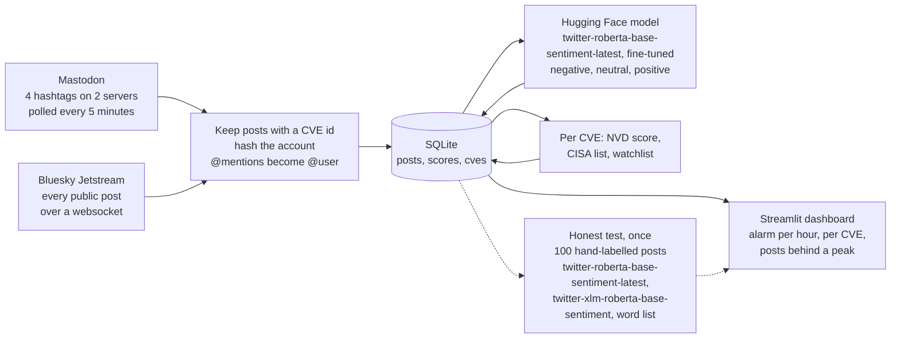

# CVE Panic Meter

AI for Good, Hackathon 6: Live Pulse
*Lucas Jansze, Muhammad Iqbal & Pavitra Pradeep*

We built a tool that keeps reading what the security community writes about new software vulnerabilities on Mastodon and Bluesky, and measures how alarmed those posts sound. It is meant for the information security officer of a Dutch municipality, who has to decide every week which of the many new vulnerabilities to patch first, and when one is urgent enough for an emergency patch outside the normal cycle.

The sentiment analysis is done by a pre-trained transformer from Hugging Face that we download once, fine-tune on posts from our own stream and run ourselves with the `transformers` library. No chat model and no paid API scores a post. An AI assistant did label most of the posts we fine-tuned on; the labels we test against are our own. The tool does not answer questions: it reads, measures and shows.

The project is also a test of an idea. Security people often talk about a dangerous vulnerability online before the official lists catch up. We wanted to know whether a general sentiment model can pick up that alarm, how often it gets it wrong, and whether the result is reliable enough to help someone decide what to patch first.

The short answer: as downloaded, the model is not good enough. It found about a third of the posts we had labelled alarmed, and a simple word list did better. After fine-tuning on 900 posts from our own stream it finds 18 of the 20 alarmed posts in our test and scores just above the word list (F1 0.86 against 0.83). The model finds three more alarmed posts than the word list, but also raises three more false alarms, on a small test. So the tool can point the officer to the posts worth reading, but it cannot decide for them.

| | |
|---|---|
| Tool | [`cardiffnlp/twitter-roberta-base-sentiment-latest`](https://huggingface.co/cardiffnlp/twitter-roberta-base-sentiment-latest) from Hugging Face, fine-tuned and run locally with `transformers` |
| Comparison | [`cardiffnlp/twitter-xlm-roberta-base-sentiment`](https://huggingface.co/cardiffnlp/twitter-xlm-roberta-base-sentiment) and a word list without machine learning |
| Live streams | Mastodon hashtag timelines (mastodon.social and hachyderm.io) and Bluesky Jetstream |
| Official reference | NVD API (CVSS score) and the CISA Known Exploited Vulnerabilities catalog |
| User and decision | The information security officer (CISO) of a small or mid-sized Dutch municipality, who decides which vulnerabilities to patch first and which justify an emergency patch |
| SDG | SDG 9 Industry, Innovation and Infrastructure, target 9.1 |
| Code | [`scripts/app/collector.py`](scripts/app/collector.py), [`scripts/app/dashboard.py`](scripts/app/dashboard.py) (Streamlit) and the package [`scripts/cve_meter/`](scripts/cve_meter/) |
| Collected data | [`export/posts.csv`](export/posts.csv) (1,764 analysed posts), [`export/cves.csv`](export/cves.csv) (the official sources per CVE) and [`export/health.csv`](export/health.csv) (the record of the run, 66.6 hours) |
| Test table | [`evaluation/test_table.csv`](evaluation/test_table.csv): our labels for 100 posts next to the output of every model and the word list, with where they disagree with us and with each other |
| Training set | [`evaluation/train.csv`](evaluation/train.csv): the 900 labelled posts we fine-tuned on, none of them in the test |
| Ethical reflection | [`ETHICS.md`](ETHICS.md) |
| How every step works, in detail | [`docs/workflow.md`](docs/workflow.md) |
| Slides | [`CVE_Panic_Meter.pptx`](../presentation/CVE_Panic_Meter.pptx) |
| Demo video | <https://youtu.be/q9XvFl7muOY> (also in [`demo_video.txt`](../presentation/demo_video.txt)) |

---

## Problem definition

A CVE is a published security flaw in a piece of software, with its own number, for example CVE-2025-6543. Every CVE is a possible way in for an attacker until the organisation that uses the software installs the fix. In 2025 a record 48,185 CVEs were published, about 131 per day and 20.6% more than in 2024 (Gamblin, 2026). Nobody can look at all of them, so a security team has to choose.

The usual way to choose is the official severity score (CVSS) that the US National Vulnerability Database (NVD) gives each CVE. That score is often late or missing: only 28% of the CVEs published in 2025 got a full NVD analysis (AppSec Santa, 2026), and at the start of 2026 there were still 54,914 CVEs from 2024 and 2025 waiting in the queue (Zafran, 2026). We saw the same in our own stream. On the first day of collecting, 87 of the 89 CVEs named in our posts had no score from the NVD yet, only one from the organisation that registered the CVE. A high score also does not say whether attackers are actually using the flaw. The US agency CISA keeps a list of vulnerabilities that are known to be exploited, but it added only 245 in 2025 (Zafran, 2026), and a CVE only gets on that list after exploitation has been confirmed.

Meanwhile attackers are fast and defenders are slow. In 2025, 28.96% of the vulnerabilities that were exploited for the first time were already exploited on or before the day their CVE was published, up from 23.6% in 2024 (VulnCheck, 2026). Verizon found that organisations needed a median of 32 days to fix a vulnerability and that only 54% were fully fixed, while exploiting a vulnerability was the way in for 20% of all breaches (Infosecurity Magazine, 2025). So "which one first?" decides which door stays open the longest.

Dutch municipalities have felt this twice with the same kind of software. In January 2020 a flaw in Citrix remote-access servers was being exploited, and between 150 and 200 municipalities had to switch off their Citrix systems. Staff could no longer work from home, and in some municipalities email, parts of the website or the whole civil registry desk (Burgerzaken) stopped working (Binnenlands Bestuur, 2020). In 2025 a Citrix NetScaler flaw, CVE-2025-6543, was exploited from at least early May, while the fix only came out on 25 June. The National Cyber Security Centre (NCSC) reported that several critical Dutch organisations were broken into, among them the Public Prosecution Service, which was offline for weeks. The flaw was first described as one that could only crash the system; it later turned out attackers could take it over (BleepingComputer, 2025). That is the gap we want to close. The official description said "crash", the real risk was "take-over", and in between, specialists were discussing what they saw. Nobody at a small municipality was reading along.

This is urgent now. Since 15 August 2026 the Dutch Cybersecurity Act (Cyberbeveiligingswet, the Dutch version of the EU NIS2 directive) is in force, without a transition period. Municipalities count as essential entities: they must manage their cyber risks, implement the government security baseline BIO2 and report serious incidents within 24 hours, and the mayor and aldermen are personally responsible (Dutch IT Channel, 2026). The capacity for that is missing. The municipalities' own security service (Informatiebeveiligingsdienst, IBD) calls the structural shortage of budget, capacity and knowledge a concern (Binnenlands Bestuur, 2025), and smaller municipalities have less capacity to prepare for a cyber crisis (Binnenlands Bestuur, 2021).

**Our questions:**

1. Can a pre-trained sentiment model tell the difference between posts that sound an alarm about a vulnerability and posts that just announce it?
2. Does that alarm add something to the official sources, the CVSS score and the CISA list?
3. Is it reliable enough to help a municipal security officer decide what to patch first, and where is it not?

## SDG 9: Industry, Innovation and Infrastructure

SDG 9 asks countries to "build resilient infrastructure, promote inclusive and sustainable industrialization and foster innovation". Target 9.1 is about quality, reliable, sustainable and resilient infrastructure, with affordable and equal access for all (United Nations, n.d.).

Our project fits this target because a municipality's IT is infrastructure. It runs the civil registry, social benefits, permits and waste collection, and increasingly the bridges, locks and traffic lights; the Cybersecurity Act covers that operational technology too (Dutch IT Channel, 2026). When it goes down, residents feel it, as the Citrix shutdown of 2020 showed.

The "for all" part matters as well. Large organisations can buy commercial threat intelligence; a municipality of 30,000 inhabitants usually cannot. A tool that turns public discussion into a signal brings part of that capability to the organisations with the least capacity. The people who benefit if it works are the security officer, who can act sooner on the right vulnerability, and the residents whose services stay up.

## User group

### Who reads the pulse: the security officer of a Dutch municipality

Our user is the information security officer, usually called the CISO, of a small or mid-sized Dutch municipality. The Netherlands has 342 municipalities (CBS, 2026), and every one of them has to organise information security under the government baseline and now under the Cybersecurity Act. In a large city this is a department. In a smaller municipality it is often one person, sometimes shared with neighbouring municipalities, who also writes policy, answers audit questions and handles incidents (Binnenlands Bestuur, 2021).

Security work is mostly done by people in the middle of their career. In ISC2's survey of 15,852 security professionals, 63% were between 35 and 54 years old (ISC2, 2024). We design for someone of roughly 35 to 55 who is technically skilled and reads English security news daily, but who is not a programmer and has little time. The same survey found that 90% of teams have skills gaps. The ISC2 numbers are worldwide and only 3% of the respondents worked in the Netherlands, so we use them as an indication, not as a Dutch fact.

Their week: new vulnerabilities come in through vendor bulletins, the NCSC and the IBD. The officer decides with the IT manager or the supplier which updates go into the regular patch round and which need an emergency change, which means downtime, overtime and explaining to management why. Since August 2026 that explanation also goes up to the mayor and aldermen.

What they need from us:

- A short list of the vulnerabilities the security community is most alarmed about right now, with the official score and the "known exploited" status next to it.
- The actual posts behind a peak, so they can judge for themselves and show management why they acted.
- An honest indication of how much a score is based on and how often the model is wrong.

An example, made up to make the user concrete: Ingrid is 46 and has been the CISO of a municipality of about 35,000 inhabitants for four years, after twelve years as a system administrator. She is the only security specialist in the organisation. On Tuesday mornings she goes through the new advisories with the IT manager. Her biggest fear is not the vulnerability with the highest score, but the one that is quietly being exploited while it still sits in next month's patch round.

### Who the decision is about: residents and municipal staff

The officer makes the patch decision, but its consequences fall on others. When a vulnerability is exploited, residents can lose access to services or have their personal data stolen, and staff lose their working tools. An unnecessary emergency patch also has a cost: systems go down for an evening and the IT team works overtime. The tool should help avoid both mistakes.

### Who is not the intended user

- Home users who want to know whether they personally are at risk. The tool shows community alarm, not advice for one computer.
- Large organisations with their own security operations centre and paid threat-intelligence feeds. They already have better data.
- Anyone looking for a replacement for the NCSC, the IBD, vendor advisories or a vulnerability scanner. This is one extra signal next to those.

### Whose voices are in the stream, and who is missing

The people who write about CVEs on Mastodon and Bluesky are security researchers, system administrators, vendors, journalists and automated accounts that post every new CVE. They are mostly English-speaking, Western and technically skilled. Of the 1,764 posts we collected, 1,593 were in English.

The stream is also smaller and more automated than we expected. In a first check of the sources on 11 October 2026, three accounts wrote 90 of the 103 CVE posts in one feed. In the posts we collected, 47 of the 209 accounts look automated, and they wrote 1,325 of the 1,764 posts (75%). Many of the accounts that are left are news sites and summaries too: people who type a CVE id themselves are rare. We also listened to Bluesky for 15 minutes for replies to and quotes of the posts we had stored, hoping to find reactions without a CVE id in them. In 27,240 posts there was not one.

Several groups are missing:

- Security people who stayed on X or LinkedIn.
- Closed channels: sector CERTs, the IBD's own network and vendor customer portals.
- infosec.exchange, the Mastodon server of the security community. It closed its hashtag feeds and its terms forbid scraping, so we do not read it. Its posts only reach us when they federate to the two servers we do read.
- Non-English communities, and the many administrators who read but never post.
- People who asked not to be processed by bots. We skip their posts on purpose.
- The attackers, who do not post either.

This has a direct consequence for our user. Software that is mainly used by Dutch government, such as suppliers of municipal systems, will barely be discussed, even when it matters most to a municipality.

## Solution: from a live post to a patch decision

**Input:** new public posts that mention a CVE, as they appear on Mastodon and Bluesky. Nobody types anything in; the stream is the input.

**Output:** a dashboard that shows how alarmed the community is, per hour for the whole stream and per vulnerability over the last 24 hours, next to the official score and whether the vulnerability is known to be exploited, with the posts behind every peak.



### Step by step

One script, [`scripts/app/collector.py`](scripts/app/collector.py), runs these parts side by side and never needs a button pressed. Every setting is in [`scripts/cve_meter/config.py`](scripts/cve_meter/config.py).

1. **Fetch.** Every 5 minutes it asks two Mastodon servers for the newest posts under four hashtags, and it keeps a websocket open to Bluesky Jetstream, which pushes every new public post.
2. **Filter and clean.** Only posts with a CVE id are kept, each one once. The account is replaced by a salted hash and every @mention by `@user` before anything is written.
3. **Score.** Every minute, each post without a score goes through the Hugging Face model. The three probabilities are stored; the probability of negative is the post's alarm score.
4. **Look up.** Every CVE is looked up in the NVD and the CISA list and compared with [`watchlist.txt`](watchlist.txt), which a municipality can replace with its own software list.
5. **Store.** Everything goes into one SQLite file, `data/cve_meter.db`, with times in UTC. Per post that is the cleaned text, the time, the source, the CVE ids, the language, the three probabilities, the hashed account and whether the account looks automated. Per CVE it is the CVSS score and who gave it, the CISA status and the watchlist match. We store no account names, display names, profile pictures, profile texts or links to the post.
6. **Keep itself running.** A part that is silent for 15 minutes makes the collector stop itself so it is started again, and every 5 minutes a line goes to `data/health.csv`, our evidence for the 48 hours.
7. **Show.** [`scripts/app/dashboard.py`](scripts/app/dashboard.py) opens the database read-only and reloads every minute.

[`docs/workflow.md`](docs/workflow.md) follows one post through all of these steps and explains each of them: how the two sources are read, what the model does with a text, how the scores become the numbers on the dashboard and which file holds which part.

### The dashboard

One page, top to bottom:

- **Status line.** How many posts are analysed, how old the newest is, and a warning in bold when the collector has stopped.
- **Fixed warning.** "No alarm does not mean no risk."
- **Alarm per hour.** The average alarm of the posts written in that hour as a line, with the number of posts as bars below it, so a peak based on five posts looks different from one based on two hundred. Click a point to read the posts of that hour.
- **Vulnerabilities, last 24 hours.** A table with alarm, number of posts, number of different accounts, CVSS score with its source and CISA status. The watchlist comes first, and a switch limits the table to it. Tick a row to read the posts.
- **Official score against alarm.** A scatter plot. The interesting cases are in the corners: high alarm with a low or missing score, or a high score nobody worries about.
- **How often the model is right.** The result of our test.
- **What this must not be used for.**

A switch decides whether posts from accounts that look automated count. They are left out by default. How each number is calculated (the average, the cap per account, "low data" and the rules for automated accounts) is in [`docs/workflow.md`](docs/workflow.md#4-from-scores-to-the-numbers-on-the-dashboard).

## The model and how we use it

### Model card summary

| | |
|---|---|
| Model | [`cardiffnlp/twitter-roberta-base-sentiment-latest`](https://huggingface.co/cardiffnlp/twitter-roberta-base-sentiment-latest), revision `3216a57` (fixed in `config.py`, so everyone scores with the same weights) |
| Trained on | RoBERTa-base, trained on about 124 million tweets from January 2018 to December 2021, then fine-tuned for sentiment on the TweetEval benchmark (Loureiro et al., 2022) |
| Language | English |
| Labels | negative, neutral, positive |
| Licence | CC BY 4.0 |
| Size | About 125 million parameters, about 500 MB on disk |
| What the collector runs | This model, fine-tuned by us on 900 posts from our own stream (see [Results](#results)) |

We chose this model for three reasons. Posts on Mastodon and Bluesky are short social-media texts, the same kind of text it was trained on, with hashtags, links and abbreviations. It has a neutral label, which matters here because many CVE posts are plain announcements; a model with only positive and negative would have to force them into one of the two. And it is small enough to run all day on a normal laptop or a Raspberry Pi without a graphics card.

We also knew its weak spots before we started. It only knows English. It learned from tweets up to 2021, so newer terms are unfamiliar. And it measures general mood, not security alarm: a word like "critical" can sound negative even when it is just the official severity label, and a real warning such as "actively exploited, patch now" is written in a calm, factual tone and may come out as neutral. The test confirmed that last point: as downloaded, the model missed two in three of the posts we labelled alarmed, which is why we fine-tuned it.

### Where the model sits in the code

- **Loading.** `pipeline("sentiment-analysis", model=..., top_k=None, device=-1)` from `transformers`, in [`sentiment.py`](scripts/cve_meter/sentiment.py). The first start downloads the weights from the Hugging Face Hub and caches them. After that the model is loaded from the cache without contacting Hugging Face and runs on the processor of our own machine. We do not use Hugging Face's hosted inference or any other API. `top_k=None` makes the pipeline return all three probabilities instead of only the winning label.
- **Preparing the text.** As the model card says: user names become `@user` (already done before storing) and links become `http`. Posts longer than the model's limit of 512 tokens are cut off.
- **Scoring.** New posts are scored in batches of 16, within a minute after they arrive. The probability of the label negative is the post's alarm score.

### Why the product does not work without it

Without the model the dashboard could only count posts. A count cannot tell an account that announces every new CVE from a researcher warning that a flaw is being exploited, and it cannot see that a busy discussion is actually reassuring ("patched in an hour, low impact"). The model turns the stream into the one thing the official sources do not have: the tone of what the people closest to the problem are writing.

## The honest test

### Method

The test is 100 posts from our own stream that we labelled ourselves, by hand: 20 alarmed, 78 neutral and 2 reassuring. The assignment asks for at least 50; we labelled twice that. Every model is tested on these same 100 posts, and no model is trained on them.

There are three labels: **alarmed** (warns of danger or urges action), **neutral** (factual announcement) and **reassuring** (fixed, low impact or overhyped). They map to the model's negative, neutral and positive. We labelled the posts together, in one sitting, with the [labelling guide](docs/labelling.md) in hand: one label per post, and that label is the reference. No post had to be left out because we could not agree. Because we labelled together, we cannot report how often we would have agreed on our own, which is a weakness of this test.

We ran these on the same 100 posts with the same code ([`scripts/run_test.py`](scripts/run_test.py)):

- `cardiffnlp/twitter-roberta-base-sentiment-latest`, the one in the pipeline.
- `cardiffnlp/twitter-xlm-roberta-base-sentiment`, trained on about 198 million tweets and fine-tuned on eight languages. Dutch is not one of them, but it reads German, French and Spanish posts that `twitter-roberta-base-sentiment-latest` cannot.
- **A word list** without machine learning: words like "actively exploited", "patch now" and "0-day" count as alarmed, "not exploitable" and "low impact" as reassuring. The full lists are in [`wordlist.py`](scripts/cve_meter/wordlist.py); we fixed them before looking at any result.
- **Both models after fine-tuning** (`twitter-roberta-base-sentiment-latest` and `twitter-xlm-roberta-base-sentiment`), in two rounds. The rounds differ in the posts the models were trained on, not in the test.

### When is it good enough?

We decided this before seeing any result. We recommend a model as a way to order the list, next to the CVSS score and the CISA status, if it meets two conditions:

1. It finds at least 60% of the posts we labelled alarmed (recall of 0.60 or higher).
2. Its F1 score for alarmed is at least 0.15 higher than that of the word list. With 20 to 30 alarmed posts a smaller difference is only a few posts and could be chance.

### Results

As downloaded, neither model met the conditions. `twitter-roberta-base-sentiment-latest` found 35% of the alarmed posts (F1 0.29) and `twitter-xlm-roberta-base-sentiment` 55% (F1 0.36), and both scored far below the word list (F1 0.83). So we fine-tuned both models, twice. The test stayed the same 100 posts. What changed between the two rounds is the training data.

**Round 1, 365 training posts.** Older Mastodon posts, fetched separately from the collector and labelled by an AI assistant (Claude) with our labelling guide and then checked and corrected by us by hand.

**Round 2, 900 training posts.** 365 posts is little to learn from, and none of them came from Bluesky. So we added 234 more of the older Mastodon posts and 301 posts from our own collector, from Mastodon and Bluesky, labelled with the same guide. No text in the training set is also in the test.

Who labelled what:

| Set | Posts | Labelled by |
|---|---|---|
| Test | 100 | Us, by hand |
| Training, rounds 1 and 2 | 900 | Labelled with our labelling guide, most of them by an AI assistant (Claude). We checked those labels by hand and corrected the ones we disagreed with: 599 older Mastodon posts fetched separately (365 of them in round 1), and 301 posts from the collector |

That makes 900 posts to train on in round 2 (226 alarmed, 654 neutral, 20 reassuring). Every score below is measured against our own labels only.

| | Accuracy against our labels | Precision alarmed | Recall alarmed | F1 alarmed |
|---|---|---|---|---|
| `cardiffnlp/twitter-roberta-base-sentiment-latest` | 0.64 | 0.24 | 0.35 | 0.29 |
| `cardiffnlp/twitter-xlm-roberta-base-sentiment` | 0.60 | 0.27 | 0.55 | 0.36 |
| `cardiffnlp/twitter-roberta-base-sentiment-latest`, fine-tuned, first round (365 posts) | 0.91 | 0.79 | 0.75 | 0.77 |
| **`cardiffnlp/twitter-roberta-base-sentiment-latest`, fine-tuned, second round (900 posts)** | 0.94 | 0.82 | 0.90 | 0.86 |
| `cardiffnlp/twitter-xlm-roberta-base-sentiment`, fine-tuned, first round (365 posts) | 0.79 | 0.52 | 0.70 | 0.60 |
| `cardiffnlp/twitter-xlm-roberta-base-sentiment`, fine-tuned, second round (900 posts) | 0.91 | 0.77 | 0.85 | 0.81 |
| Word list | 0.94 | 0.94 | 0.75 | 0.83 |

With 900 posts the fine-tuned `twitter-roberta-base-sentiment-latest` finds 18 of the 20 alarmed posts, where the first round found 15, and it is the first model that scores above the word list (0.86 against 0.83). On accuracy over all 100 posts the two are equal (0.94). The model finds three more alarmed posts (18 against 15), but also calls three more neutral posts alarmed (4 against 1). It meets our first condition. It does not meet the second, which asks for 0.15 above the word list: it is 0.03 above it.

Read these numbers with three things in mind:

- **Round 2 had an advantage that round 1 did not have.** In round 1 the training posts came from another week and from Mastodon only. In round 2 posts of the same accounts, and of the same automated feeds with their fixed form, are in both the training set and the test. Part of the gain is the model recognising those accounts' way of writing.
- **100 posts with 20 alarmed is small,** even though it is twice the 50 the assignment asks for. One alarmed post more or less moves recall by 0.05. The fine-tuned `twitter-roberta-base-sentiment-latest` finds three alarmed posts more than the word list, and makes three false alarms more.
- **Most training labels were first made by an AI.** We checked them by hand and corrected the ones we disagreed with. The AI marked 47 of its labels as doubtful, mostly posts that say there is no patch and tell the reader to restrict access. Our labelling rules also turn largely on fixed phrases such as "exploited in the wild", which is exactly what a word list is good at.

The collector scores with `twitter-roberta-base-sentiment-latest`, fine-tuned in the second round. All posts are scored with that model, so the chart has one model from start to end. The model folders are not in git because of their size, but the 900 training posts are: [`evaluation/train.csv`](evaluation/train.csv) has the text, the label, whether the labeller doubted it, and in the column `origin` which batch it came from (`backfill_1` is the 365 posts of round 1). With it, `scripts/finetune.py` makes the fine-tuned model again; the command is in [`docs/workflow.md`](docs/workflow.md#9-where-it-runs-and-what-to-type).

Running `scripts/run_test.py` writes the test table (every labelled post with our label and the output of each model and the word list) and `evaluation/results.json`, which feeds the panel on the dashboard. Two columns show where they disagree: `disagrees_with_us` names every model that chose another label than ours, and `roberta_vs_xlm_roberta` says whether `twitter-roberta-base-sentiment-latest` and `twitter-xlm-roberta-base-sentiment` as downloaded agree (they differ on 22 of the 100 posts).

### Three failures

The model we use (`twitter-roberta-base-sentiment-latest`, fine-tuned in the second round) got 6 of the 100 test posts wrong: it called 4 neutral posts alarmed and 2 alarmed posts neutral. All six are in `evaluation/test_table.csv`, which `scripts/run_test.py` writes (posts 17, 55, 67, 121, 129 and 172). Three of them:

**1. "Critical" as a severity label (post 67).** Our label: neutral. The model: alarmed.

> Citrix Patches Critical NetScaler Memory Overflow Flaw (CVSS 9.5) That Enables Remote Code Execution in SAML Deployments Citrix patches CVE-2026-107406, a critical NetScaler memory overflow flaw rated CVSS 9.5 that can enable remote code execution or denial of service

This is a news headline about a patch that is out. Nobody says it is being exploited or that you should hurry. We think the model reacts to "critical", "9.5" and "remote code execution" together. In the training set, headlines of the form "X patches Y" were labelled alarmed twice as often as neutral (12 against 6), because many of them also mention exploitation, so the model learned the form and not the reason. Post 17, about an Exchange patch, went wrong the same way.

**2. A real warning in a flat tone (post 129).** Our label: alarmed. The model: neutral.

> CVE-2026-108707 + CVE-2026-108708 — Wukong_HRM 9.8: omit AUTH-TOKEN header → full HR admin. No auth needed. 8.8: any authenticated employee → HR admin automatically via EmployeeAspect. Public PoC available. No patch. [...] Payslips, salaries, employee PII — all exposed.

A public exploit, no patch and personal data in the open is exactly what our user needs to hear about. But the post is written as a list of facts, without a word like "urgent" or "exploited in the wild". We think that is why the model misses it. It is also the kind of post our training labels are weakest on: of the training posts that say "no patch", 27 are labelled neutral and 26 alarmed. The word list did get this one right.

**3. An automated advisory that does tell you to act (post 55).** Our label: alarmed. The model: neutral.

> 🔴 New security advisory: CVE-2026-106610 affects multiple systems. • Impact: Remote code execution or complete system compromise possible • Risk: Attackers can gain full control of affected systems • Mitigation: Patch immediately or isolate affected systems [...]

We labelled it alarmed because it says "patch immediately". We think the model sees the form first: an emoji, a CVE number and a fixed list of points, like the automated feeds that make up a large part of the training set and are almost always neutral. This account was not in the training set, so the model had only the form to go on. The cost for our user is small here, because automated accounts are left out of the averages by default.

The other two false alarms (posts 121 and 172) are short posts with heavy words ("unauthenticated attackers crash", "new Spectre v2 threat") and no call to act.

Of the kinds of failure we expected beforehand, we saw "critical" used as a severity label and real warnings in a factual tone that come out as neutral. We expected automated posts full of alarming words to come out as alarmed, and saw the opposite in post 55. We did not see sarcasm ("great, another 10.0 on a Monday, love it"), posts that are positive about a quick fix for a serious problem, or posts in other languages: with 100 posts, almost all in English, the test is too small to say anything about those.

### A failure outside the test: Japanese posts

The collected data shows one failure the test could not. The second-largest language in our stream is Japanese: 120 of the 1,764 posts, all from Bluesky. The model calls 100 of them alarmed. Their average alarm score is 0.83, against 0.18 for the English posts.

Some of those posts do warn. One says the flaw is "actively exploited" and another is headed 緊急, "urgent". But the model was trained on English only and cannot read them, so a high score on a Japanese post tells us nothing. It looks as if the model reads text it does not understand as negative. We did not label any Japanese posts, so we cannot say how often it happens to be right.

What it does to the dashboard: 102 of the 120 posts come from accounts that look automated and are left out by default. The other 18 count, spread over 13 CVEs. Ten of those CVEs have fewer than 5 counted posts and are marked low data anyway. For the three busier ones, 2 Japanese posts sit among 17 to 47 counted posts. So the effect is small now, but in a week with more Japanese posts about one vulnerability it could push that vulnerability up the list for the wrong reason. Every non-English post already carries the note "the model only reads English" on the dashboard. The next step would be to leave those posts out of the averages by default, the way we do with automated accounts. Our test of 100 posts, almost all in English, could not show this failure. We only found it by looking at what the collector had stored.

### Which one would we hand to the user?

Not one of the two models as downloaded. `twitter-roberta-base-sentiment-latest` and `twitter-xlm-roberta-base-sentiment` both lost to a word list that has no machine learning in it, and `twitter-roberta-base-sentiment-latest` missed two in three of the alarmed posts.

We would hand over `twitter-roberta-base-sentiment-latest`, fine-tuned in the second round, which is what the collector runs, and we would say with it that it has not passed our own bar. The reason to prefer it over the word list is the kind of mistake it makes. For our user a missed alarm is worse than a false one, and the model finds 18 of the 20 alarmed posts where the word list finds 15. The price is more false alarms: about one in five of the posts the model calls alarmed is not, against one in sixteen for the word list. The word list also only knows the phrases we wrote down, while the model was trained on posts and can pick up a warning that is worded differently.

By the two conditions we set beforehand, the model has only earned the first. That is why the dashboard shows the test result next to the chart, and why the alarm score is one column next to the CVSS score and the CISA status and never replaces them.

## Problem-solution fit

The problem is not that the officer lacks information. The information that matters arrives late and is buried: the official score is missing in the first days and the CISA list only confirms exploitation after it has happened, so a weekly patch meeting that waits for those sources is too late for exactly the vulnerabilities that hurt most. What arrives early is the conversation among specialists, but nobody in a small municipality can read hundreds of posts a day. Reading continuously and summarising the tone is what a sentiment model can do and a person cannot.

### Why sentiment, and not something simpler

| Simpler alternative | Why it is not enough on its own |
|---|---|
| Only the official CVSS score | It is missing for most new CVEs, and the score of the registering organisation we fall back on is not independent. Both measure theoretical severity, not whether people are worried it is being attacked now |
| Only the number of posts | Automated accounts post every CVE, and a busy discussion can be calm. Volume is not alarm |
| Waiting for the CISA list | A vulnerability is only added after exploitation is confirmed, which is the moment you wanted to be ahead of |
| A list of alarm words | This came closer than we expected: in our test it scored almost as high as the fine-tuned model (F1 0.83 against 0.86). But it found 15 of the 20 alarmed posts where the model found 18, and it only knows the phrases we wrote down |

We do not replace any of these. The dashboard shows them side by side, and the model adds the one signal the others lack.

### Why this fits this user

- **It matches the decision they already make.** The officer already sorts vulnerabilities into "next round" and "now". The tool adds no step; it changes the order of the list they already go through, and points to the few cases where the community is worried while the official score is low or missing.
- **It gives evidence, not just a number.** An emergency patch costs downtime and overtime, and the mayor and aldermen are now accountable. Being able to open the posts behind a peak is an argument the officer can take to the IT manager or the board. A bare score is not.
- **It fits their skills and their time.** Our user reads English security news and knows what a CVE is. But they have no time to read Mastodon all day and no budget for commercial threat intelligence. The tool runs on its own, costs a laptop or a Raspberry Pi, and takes a few minutes a day to look at.
- **It is honest about its limits.** A security officer is trained to distrust tools. The dashboard shows the number of posts and accounts next to every score, the model's tested accuracy, and the warning that silence is not safety.

### Is it reliable enough for the decision?

Reliable enough to decide which posts to read first, not reliable enough to decide what to patch. The fine-tuned model finds most of the alarmed posts in our test, but that test is 100 posts with 20 alarmed, and the lead over a word list is three posts. So the alarm score may put a vulnerability higher on the officer's list and send them to the posts behind it. The patch decision stays with the officer, on the posts themselves and on the official sources.

Where it is not reliable:

- The tool does not know which software a municipality uses. The watchlist is a general starting list, not their inventory. The logical next step is to fill it from the municipality's own asset list.
- Community alarm measures worry, not risk. A vulnerability can be dangerous without anyone posting about it. That is why the tool may move a vulnerability up the list, never down.
- Negative sentiment is not the same as alarm, and the model can miss in both directions. That is why we rank vulnerabilities against each other instead of using a fixed threshold, and why we report separately how many of the alarmed posts the model finds.
- The stream is thin. Of the 847 CVEs our posts mention, 800 had too few posts or accounts and were marked low data. For most vulnerabilities the dashboard will say "we do not know", and that is the honest answer.

## Working prototype

The prototype counts as working when the collector has run on its own for at least 48 hours, has stored at least 300 analysed posts, and the dashboard shows up-to-date data without anyone pressing a button.

| | Needed | Result |
|---|---|---|
| Analysed posts | 300 | 1,764 |
| Hours collected | 48 | 66.6 |
| Posts without a score | 0 | 0 |
| CVEs looked up in the NVD | all | all 848 (847 still in a stored post, see below) |

`python scripts/db_status.py` prints these numbers from the database and from `data/health.csv`.

The collected data is in [`export/`](export/), made on 14 October 2026 at 14:11 UTC from one copy of the database: `posts.csv` has one row per post (when it was written and stored, the source, the language, the hashed account, whether the account looks automated, the CVE ids, the three probabilities and the label of our model, and the text), `cves.csv` has what the NVD and CISA say per CVE, and `health.csv` is the record of the run. The numbers above come from these files. The database itself is not in git. `cves.csv` has 848 CVEs and the posts mention 847: CVE-2022-0995 is in no stored post any more, most likely because its author deleted the post, which makes us delete our copy, while the CVE stays in the list.

The code has 68 unit tests for the parts that are easy to get wrong without noticing: skipping duplicates, hashing, the per-account cap, low data, the bot rules, the NVD score choice and the health record.

## How to run

Needs Python 3.10 or newer (built with 3.12) and about 1 GB of free disk space for the model.

Every command below runs from the folder this README is in, `Term 1/Week 6/hackathon/` in the portfolio:

```bash
cd "Term 1/Week 6/hackathon"
```

```bash
python -m venv .venv
```

On Windows:

```bash
.venv\Scripts\pip install -r requirements.txt
```

On Linux, install the processor-only build of PyTorch first:

```bash
.venv/bin/pip install torch --index-url https://download.pytorch.org/whl/cpu
```

```bash
.venv/bin/pip install -r requirements.txt
```

Copy `.env.example` to `.env`. Fill in `CONTACT` (an email address, sent as User-Agent so a server admin can reach us) and, if you have one, your own free [NVD API key](https://nvd.nist.gov/developers/request-an-api-key). It works without a key, only slower. An NVD key is personal: do not share one.

Start the collector (on Linux: `.venv/bin/python`):

```bash
.venv\Scripts\python scripts/app/collector.py
```

The first start downloads the model, creates `salt.txt` and creates the database. Leave it running and stop it with Ctrl+C. It can be started again at any time: posts it already has are skipped and whatever has no score yet is caught up. A fresh clone scores with `twitter-roberta-base-sentiment-latest` as downloaded, because the fine-tuned model folders are not in git. To score with our model, first run the fine-tune command in [`docs/workflow.md`](docs/workflow.md#9-where-it-runs-and-what-to-type); it trains on `evaluation/train.csv` and writes `models/model-a-finetuned-2/`, which the collector then picks up.

Start the dashboard in a second terminal and open http://localhost:8501:

```bash
.venv\Scripts\streamlit run scripts/app/dashboard.py
```

Other commands:

| Command | What it does |
|---|---|
| `python scripts/db_status.py` | What is in the database, and how far the 48 hours are |
| `python -m unittest discover -s scripts/tests -t scripts` | Runs the tests. They need no network and no model |

For a run of days, start the collector with anything that starts it again when it stops, such as a systemd service or a container with a restart policy. What it does to keep itself going is in [`docs/workflow.md`](docs/workflow.md#8-how-it-keeps-running).

Built and run with Python 3.12, transformers 5.19, PyTorch 2.14 (CPU) and Streamlit 1.65.

## The streams and their terms

What each source's terms say, with a link to the text we read.

| Source | Role | Key | What the terms say, and what we do |
|---|---|---|---|
| Mastodon: mastodon.social, hachyderm.io | Main text stream | None | We found no clause against reading the public API ([terms of mastodon.social](https://mastodon.social/terms-of-service), [rules of hachyderm.io](https://hachyderm.io/about)). We send 8 requests per 5 minutes against a limit of 300, read each server's access setting and respect it, and skip accounts that opted out |
| Mastodon: infosec.exchange | Not used | | Feeds are closed and [its terms](https://infosec.exchange/terms-of-service) ask written permission for scraping |
| Bluesky Jetstream | Second text stream | None | Bluesky names "student projects" and "informal metrics and visualizations" as a good fit and research studies as a bad one ([Jetstream announcement](https://docs.bsky.app/blog/jetstream)). The [developer guidelines](https://docs.bsky.app/docs/support/developer-guidelines) ask for deletion of what a user deleted, which the collector does |
| NVD API | CVSS score | Optional, personal | At most one request per 6 seconds, and the notice below ([terms of use](https://nvd.nist.gov/developers/terms-of-use)) |
| CISA KEV catalog | Known exploited | None | [CC0](https://www.cisa.gov/sites/default/files/licenses/kev/license.txt). One download per hour |

This product uses the NVD API but is not endorsed or certified by the NVD.

## What this must not be used for

- As the only basis for a patch decision, or as a reason to skip or postpone a patch. Low alarm is not low risk.
- To rank, follow or judge individual people, such as researchers or suppliers. Account names are not stored for that reason.
- To claim that an organisation is or is not compromised.
- As research data about who said what. Bluesky says Jetstream is not meant for that, and our data is not built for it.
- As a public website. The post texts can be searched online to find their authors, so the dashboard only listens on the machine it runs on.

## Ethical reflection

The full reflection is in [`ETHICS.md`](ETHICS.md). The short version: the biggest risk is that the officer reads a quiet line as "no problem". The stream is English-speaking and Western, and software used mainly by Dutch municipalities is hardly discussed in it, so a dangerous flaw in exactly that software stays quiet. We respond by showing the number of posts and accounts next to every score, marking thin scores as low data, always showing the CISA status, and putting a fixed warning on the dashboard. A handful of automated accounts writes most of the stream, so we count each account at most three times and leave out accounts that look automated. The model only reads English and does not know security jargon, so we test it on our own posts and show the result on the dashboard. And the posts were written by real people who did not ask to be analysed, so we store no names or profiles, skip accounts that opted out, delete what Bluesky authors delete, and keep the post texts out of public view.

## How we worked on this

**Our own choices.** We came up with the idea and chose the user ourselves: a municipal security officer who has to decide what to patch first. We set the bar for "good enough" before we saw any result. When the model as downloaded found only 7 of the 20 alarmed posts, we were disappointed and decided ourselves to fine-tune it on posts from our own stream.

**Where AI helped.** We used Claude to check whether the APIs were usable and to improve the plan, and Claude Code to write the code, step by step, with us directing and checking each step. Claude also labelled most of the 900 training posts with our labelling guide; we checked them by hand and corrected the ones we disagreed with. The 100 test posts we labelled ourselves. Claude Code also wrote a first version of the review of the sources' terms and helped with the wording of this README; we checked every link, number and source.

**What AI does not do.** No chat model scores a post. Every post is scored by the Hugging Face model above, loaded and run by our own code.

## What we learned

### Lucas Jansze

What surprised me most was how much better the model got after fine-tuning. As downloaded, `twitter-roberta-base-sentiment-latest` found only 7 of the 20 posts we labelled alarmed (F1 0.29), and it lost to a simple list of phrases without any machine learning (F1 0.83). After fine-tuning on 365 of our own posts, its F1 went to 0.77. With 900 posts it went to 0.86 and it found 18 of the 20 alarmed posts, the first time a model beat the word list. `twitter-xlm-roberta-base-sentiment` showed the same jump, from 0.36 to 0.81. I had not expected that a few hundred short posts could change so much in a model trained on 124 million tweets. It showed me that a general model knows the language, but only learns what alarm means in security when you show it examples from your own stream.

### Muhammad Iqbal

Through this project, I learned about CVE and CVSS, and how official severity metrics often lag behind real-time community discussions. I also gained hands-on experience with NLP, observing how pre-trained AI models struggle with domain-specific nuance and why fine-tuning is essential for accurate sentiment detection. Furthermore, I learned about SDG 9 (Industry, Innovation, and Infrastructure) and how accessible threat intelligence contributes to resilient infrastructure. Finally, I explored social data ingestion by working with live feeds from decentralized platforms like Mastodon and Bluesky.

### Pavitra Pradeep

In this project, I learned how to use pretrained transformer models in a real application instead of only studying them in theory. Working with Hugging Face sentiment models taught me how to run them on short, messy social media posts, and that multilingual input needs a model that can handle it. I learned that live data is noisy, so a good result depends as much on cleaning and filtering as on the model. I also learned that a high sentiment score doesn’t prove a vulnerability is serious, so we had to combine the social signal with hard data on which CVEs are actually exploited. Working with Lucas and Iqbal, I learned to split the work clearly and keep our parts compatible, so the whole tool worked together. Finally, I learned to explain how and why I used each tool in building the product, instead of only showing the result.

## Sources

- AppSec Santa (2026). [Software vulnerability statistics](https://appsecsanta.com/research/software-vulnerability-statistics). Share of 2025 CVEs with full NVD analysis.
- Binnenlands Bestuur (2020, 22 January). [Citrix-lek toont waarde ICT-samenwerking gemeenten](https://www.binnenlandsbestuur.nl/digitaal/schuldhulp-en-armoedebeleid/citrix-lek-toont-waarde-ict-samenwerking-gemeenten).
- Binnenlands Bestuur (2021, 19 February). [Geen enkele gemeente echt voorbereid op een cybercrisis](https://www.binnenlandsbestuur.nl/digitaal/geen-enkele-gemeente-echt-voorbereid-op-een-cybercrisis). Research by De Haagse Hogeschool and NHL Stenden.
- Binnenlands Bestuur (2025, 6 June). [IBD: digitale veiligheid gemeenten verder onder druk](https://www.binnenlandsbestuur.nl/digitaal/ibd-digitale-veiligheid-gemeenten-verder-onder-druk). On the IBD Dreigingsbeeld Informatiebeveiliging 2025-2026.
- BleepingComputer (2025). [Netherlands: Citrix Netscaler flaw CVE-2025-6543 exploited to breach orgs](https://www.bleepingcomputer.com/news/security/netherlands-citrix-netscaler-flaw-cve-2025-6543-exploited-to-breach-orgs/).
- Bluesky (2024). [Introducing Jetstream](https://docs.bsky.app/blog/jetstream).
- CBS (2026). [Gemeentelijke indeling op 1 januari 2026](https://www.cbs.nl/nl-nl/onze-diensten/methoden/classificaties/overig/gemeentelijke-indelingen-per-jaar/indeling-per-jaar/gemeentelijke-indeling-op-1-januari-2026).
- CISA. [Known Exploited Vulnerabilities catalog](https://www.cisa.gov/known-exploited-vulnerabilities-catalog).
- Dutch IT Channel (2026, 17 August). [VNG luidt noodklok over cyberveiligheid](https://www.dutchitchannel.nl/news/757680/vng-luidt-noodklok-over-cyberveiligheid). On the Cyberbeveiligingswet in force since 15 August 2026.
- Gamblin, J. (2026). [2025 CVE Data Review](https://jerrygamblin.com/2026/01/01/2025-cve-data-review/).
- Hugging Face (n.d.-a). [cardiffnlp/twitter-roberta-base-sentiment-latest](https://huggingface.co/cardiffnlp/twitter-roberta-base-sentiment-latest), model card.
- Hugging Face (n.d.-b). [cardiffnlp/twitter-xlm-roberta-base-sentiment](https://huggingface.co/cardiffnlp/twitter-xlm-roberta-base-sentiment), model card.
- Infosec Exchange (2026). [Server information and rules](https://infosec.exchange/about).
- Infosecurity Magazine (2025, 23 April). [Verizon's DBIR reveals 34% jump in vulnerability exploitation](https://www.infosecurity-magazine.com/news/verizon-dbir-jump-vulnerability/).
- ISC2 (2024). [2024 ISC2 Cybersecurity Workforce Study](https://www.isc2.org/Insights/2024/10/ISC2-2024-Cybersecurity-Workforce-Study). 15,852 respondents; age distribution in Appendix A.
- Loureiro, D., Barbieri, F., Neves, L., Espinosa Anke, L. & Camacho-Collados, J. (2022). [TimeLMs: Diachronic language models from Twitter](https://aclanthology.org/2022.acl-demo.25). ACL 2022 System Demonstrations.
- Mastodon (n.d.). [Timelines API methods](https://docs.joinmastodon.org/methods/timelines/).
- NIST. [National Vulnerability Database, API terms of use](https://nvd.nist.gov/developers/terms-of-use).
- United Nations (n.d.). [Goal 9, targets and indicators](https://sdgs.un.org/goals/goal9).
- VulnCheck (2026). [State of Exploitation 2026](https://www.vulncheck.com/blog/state-of-exploitation-2026).
- Zafran (2026). [The 2025 spike in vulnerabilities isn't the full story](https://www.zafran.io/resources/the-2025-spike-in-vulnerabilities-isnt-the-full-story). NVD backlog and CISA KEV figures.
